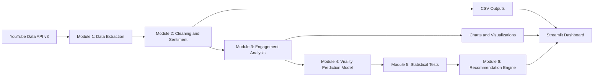
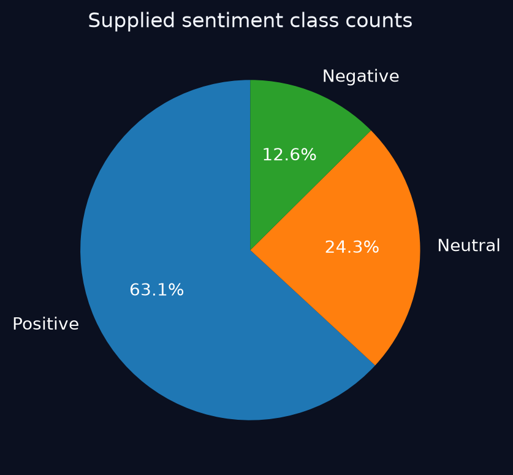
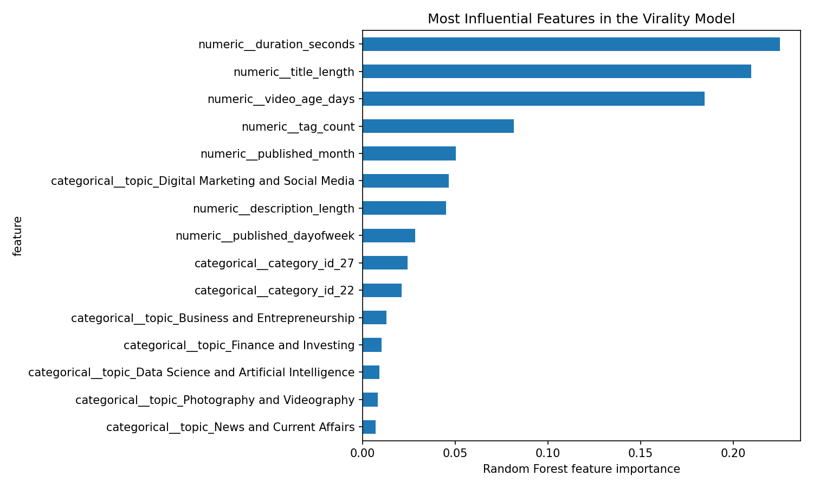

# Data-Driven Social Engagement Initiative

**A Major Project Report**

*Analysis of YouTube Video Engagement, Audience Sentiment and Virality Prediction*

**Submitted by:** Devesh Vishwasrao

---

## Abstract

The Data-Driven Social Engagement Initiative investigates YouTube video performance by combining video metadata, audience comment sentiment, topic comparison, engagement analysis and predictive modelling. The project is implemented as a modular Python pipeline that covers data extraction through the YouTube Data API, comment cleaning, sentiment classification, engagement-rate computation, statistical testing, recommendation generation and an interactive Streamlit dashboard.

Comment sentiment is classified with the VADER lexicon-based analyser, and engagement metrics are derived from views, likes and comments. A Random Forest regressor is trained on features such as topic, category, duration, publication timing, title length, description length and tag count to model engagement rate. Non-parametric statistical tests (Kruskal-Wallis and pairwise Mann-Whitney U with Bonferroni adjustment) are used to compare engagement across topics, and a recommendation layer converts the results into content-strategy guidance.

The results show clear differences in engagement between topics. Digital Marketing and Social Media, Finance and Investing, and Photography and Videography are among the highest-engagement topics, while Education and Music show the lowest average engagement. About 63.1% of the analysed comments are positive, 24.3% are neutral and 12.6% are negative. In the virality model, video duration, title length and video age are the most influential features. The report documents the system architecture, methodology, analytical results and limitations of the project.

## Table of Contents

- [Abstract](#abstract)

- [1. Introduction](#1-introduction)

- [2. Problem Statement](#2-problem-statement)

- [3. Project Objectives](#3-project-objectives)

- [4. Scope of the Project](#4-scope-of-the-project)

- [5. Background](#5-background)

- [6. System Requirements](#6-system-requirements)

- [7. System Architecture and Workflow](#7-system-architecture-and-workflow)

- [8. Dataset Description](#8-dataset-description)

- [9. Data Collection and Preprocessing](#9-data-collection-and-preprocessing)

- [10. Sentiment Analysis](#10-sentiment-analysis)

- [11. Engagement Analysis](#11-engagement-analysis)

- [12. Virality Prediction Model](#12-virality-prediction-model)

- [13. Statistical Analysis](#13-statistical-analysis)

- [14. Recommendation System](#14-recommendation-system)

- [15. Streamlit Dashboard Implementation](#15-streamlit-dashboard-implementation)

- [16. Results and Discussion](#16-results-and-discussion)

- [17. Limitations](#17-limitations)

- [18. Conclusion and Future Scope](#18-conclusion-and-future-scope)

- [References](#references)

- [Appendix A: Repository Files Used](#appendix-a-repository-files-used)

## 1. Introduction

Social media platforms have become a major source of digital influence, content consumption and audience engagement. YouTube, in particular, generates large volumes of user-generated comments, topic trends and measurable performance indicators such as views, likes, comments and engagement rate. Understanding which video topics attract stronger engagement, and whether content themes correlate with audience sentiment, is valuable for creators, marketers, educators and digital strategists.

The Data-Driven Social Engagement Initiative analyses this problem from a data-driven perspective. It combines the collection of YouTube video metadata, comment-level sentiment analysis, topic-wise engagement comparison and predictive modelling to identify patterns and provide content recommendations. The implementation is organised into separate modules:

- module1_data_extraction.py: YouTube video and comment extraction

- module2_cleaning_sentiment.py: data cleaning and VADER-based sentiment classification

- module3_engagement_analysis.py: engagement metric calculation and topic summarisation

- module4_virality_model.py: feature engineering and the virality prediction model

- module5_statistical_tests.py: non-parametric hypothesis testing

- module6_recommendations.py: topic-level strategic recommendations

- module7_visualizations.py: chart generation

- app.py (04_Dashboard): Streamlit dashboard for interactive exploration

## 2. Problem Statement

YouTube content creators and digital marketing teams often struggle to predict which topics and content formats will generate meaningful engagement. Video performance is influenced by multiple factors, including content topic, channel authority, publication timing, duration, title style, description length and audience sentiment. These relationships are not always obvious, and they differ across industries and topics.

Traditional content-strategy decisions are frequently based on intuition rather than evidence, so creators may produce content that is popular in general but not aligned with the preferences of their target audience. There is therefore a need for a systematic, data-driven approach to understand video engagement, analyse public sentiment, compare topics statistically, model virality potential and provide actionable recommendations.

This project addresses the problem by building a pipeline that captures YouTube data, classifies audience sentiment in comments, compares engagement across topics and applies machine-learning techniques to model engagement-related outcomes.

## 3. Project Objectives

The primary objectives of the project are as follows:

- To collect YouTube video and comment data across multiple topic categories using the YouTube Data API.

- To clean and preprocess the collected data for analytical use.

- To analyse audience sentiment from comment text using a lexicon-based method.

- To compute engagement metrics such as engagement rate, like rate and comment rate.

- To compare topic-wise video performance and identify meaningful differences.

- To build a Random Forest model for engagement rate and identify the most influential features.

- To perform statistical tests to assess whether engagement differs significantly across topics.

- To generate recommendations for content strategy based on topic performance and sentiment patterns.

- To implement a user-friendly Streamlit dashboard for interactive exploration of the dataset.

## 4. Scope of the Project

The scope of the project covers the following:

- YouTube video metadata and comment extraction across twenty selected topics

- English-language comment analysis using VADER sentiment scoring

- Engagement metrics computed from visible interaction counts (views, likes and comments)

- Topic-based comparison of engagement and sentiment

- Random Forest regression for engagement prediction

- Non-parametric statistical testing for topic comparison

- Recommendation generation based on computed engagement and sentiment statistics

- Visualisation through chart files and a Streamlit dashboard

The project does not claim to cover all social media platforms, all content genres or all YouTube topics globally. The analysis is based on the data sample assembled by the project code. It does not model watch-time retention, share rate or long-term channel performance.

## 5. Background

The analysis of social media engagement has gained increasing attention in digital marketing, content analytics and online community studies. Research in this domain often focuses on identifying the features that influence user interaction with digital content. On YouTube, factors such as title attractiveness, video duration, publishing time, category, channel popularity and topical relevance can affect audience response. Sentiment in comments also serves as a useful proxy for audience opinion.

Several analytical approaches are commonly used in this area: descriptive analytics for summary statistics and topic comparison; sentiment analysis to identify positive, neutral and negative audience reactions; statistical testing to compare engagement across groups; machine-learning models to predict content performance; and recommendation systems to suggest content directions.

The project follows this general approach. It uses VADER, a rule-based sentiment model that is well suited to short, informal text such as social-media comments. It uses a Random Forest regressor because tree-based ensembles can capture nonlinear relationships among variables such as duration, topic, tags and publication characteristics. Non-parametric statistical tests are used because engagement-rate distributions often do not satisfy the assumption of normality.

## 6. System Requirements

The project runs in a Python environment. The dependencies listed in requirements.txt are:

- pandas and numpy for data loading and transformation

- matplotlib, seaborn and plotly for visualisation

- scikit-learn for machine-learning model training and evaluation

- jupyter for notebook-based experimentation

- streamlit for dashboard development

In addition, the sentiment module imports the vaderSentiment package and the statistical module relies on SciPy for the Kruskal-Wallis and Mann-Whitney U tests. Data extraction requires a YouTube Data API v3 key.

## 7. System Architecture and Workflow

The project architecture is a modular pipeline running from data acquisition to dashboard presentation, as shown in Figure 1.

<b>Figure 1.</b> <em>System architecture and workflow of the Data-Driven Social Engagement Initiative.</em>

### 7.1 Workflow Description

1. Data collection begins with the YouTube Data API, which is searched for videos across predefined topics to retrieve metadata and comments.
2. The extracted data is stored as CSV outputs, such as youtube_videos.csv and youtube_comments.csv.
3. Cleaning removes empty or duplicate rows and prepares the comments for sentiment analysis.
4. Sentiment labels are assigned to each comment using VADER.
5. Engagement metrics are computed from views, likes and comments at the video level.
6. The combined dataset is used for topic comparison, statistical testing and recommendation generation.
7. A Random Forest regressor is trained on engineered metadata features to model engagement rate.
8. Results are saved as CSV outputs and charts and are displayed in the Streamlit dashboard.

## 8. Dataset Description

The 02_Datasets directory of the project contains the following files:

- youtube_videos.csv and youtube_comments.csv (raw extracted data)

- youtube_comments_sentiment.csv (comments with sentiment labels and scores)

- youtube_complete_analysis.csv and complete_video_analysis.csv (combined video-level analysis)

- topic_metrics.csv and topic_sentiment_comparison.csv (topic-level summaries)

- topic_pairwise_tests.csv (pairwise statistical test results)

- topic_recommendations.csv and engagement_recommendations.csv (recommendation outputs)

### 8.1 Video-Level Fields

Each video record contains the following fields where available: video_id, topic, title, channel_title, channel_id, published_at, description, tags, category_id, duration, view_count, like_count, comment_count, engagement_rate_pct, like_rate_pct, comment_rate_pct, positive_pct and average_sentiment_score.

### 8.2 Comment-Level Fields

Each comment record contains comment_id, comment_text, sentiment and sentiment_score.

## 9. Data Collection and Preprocessing

### 9.1 Data Collection Strategy

The extraction module (module1_data_extraction.py) uses the YouTube Data API to gather video data across twenty predefined topics: Gaming, Technology, Education, Fitness and Health, Food and Cooking, Travel and Tourism, Entertainment and Movies, Music, Sports, Finance and Investing, Fashion and Beauty, Science and Space, Comedy, News and Current Affairs, Lifestyle and Vlogging, Data Science and Artificial Intelligence, Business and Entrepreneurship, Motivation and Self-Improvement, Photography and Videography, and Digital Marketing and Social Media.

The extraction logic searches YouTube for videos within each topic, restricts the relevance language to English, orders results by view count and stores unique video IDs to avoid duplication. It then retrieves detailed metadata (title, channel, description, tags, category, duration and view, like and comment counts) and collects comment threads, up to 100 comments per video, through the commentThreads endpoint. Safeguards handle API quota limits and HTTP errors.

### 9.2 Preprocessing Steps

The cleaning module (module2_cleaning_sentiment.py) reads the raw video and comment files, removes empty text values, strips whitespace, removes duplicate comment IDs, keeps only non-empty comments and standardises the comment_text field for downstream analysis. This step is important because YouTube comments often contain noise, duplicates and incomplete values.

### 9.3 Engagement Metric Engineering

In module3_engagement_analysis.py, the following metrics are derived at the video level:

*Engagement Rate (%) = (like_count + comment_count) / view_count × 100*

*Like Rate (%) = like_count / view_count × 100*

*Comment Rate (%) = comment_count / view_count × 100*

Converting raw counts into normalised rates makes videos with different audience sizes comparable.

## 10. Sentiment Analysis

Sentiment analysis is implemented in module2_cleaning_sentiment.py using VADER (SentimentIntensityAnalyzer from the vaderSentiment package). A compound score is computed for each comment and the comment is labelled according to the following rule:

- Positive, if the compound score is greater than or equal to 0.05.

- Negative, if the compound score is less than or equal to -0.05.

- Neutral, otherwise.

This mechanism suits social-media text because it handles informal language and short, expressive comments. The code then computes sentiment counts and percentages by topic.

Figure 2 shows the overall sentiment class distribution. Positive comments account for 63.1% of the comments, neutral comments for 24.3% and negative comments for 12.6%. The audience response in the sample is therefore predominantly positive, and negative comments form the smallest share.

<b>Figure 2.</b> <em>Distribution of comment sentiment classes (Positive 63.1%, Neutral 24.3%, Negative 12.6%).</em>

## 11. Engagement Analysis

Engagement analysis is implemented in module3_engagement_analysis.py. The module calculates video-level engagement and aggregates the metrics by topic, computing the video count, average views, average engagement rate, average like rate, average comment rate and average positive-sentiment percentage for each topic.

Figure 3 presents the average engagement rate for each of the twenty topics. Digital Marketing and Social Media has the highest average engagement rate (approximately 3.6%), followed by Finance and Investing, Photography and Videography, Business and Entrepreneurship, News and Current Affairs, and Data Science and Artificial Intelligence, all above 3%. At the lower end, Music and Education record average engagement rates below 0.5%. Engagement therefore differs substantially across topic groups.

<b>Figure 3.</b> <em>Average YouTube engagement rate (%) by topic.</em>

Table 1 presents the topic ranking from topic_recommendations.csv, ordered by median engagement rate. The median is less sensitive than the mean to individual viral videos, which makes it a more robust basis for comparing topics.

**Table 1.** Topic recommendation summary (source: topic_recommendations.csv).

| **Topic**                                | **Video Count** | **Median Engagement (%)** | **Mean Engagement (%)** |
|------------------------------------------|-----------------|---------------------------|-------------------------|
| Finance and Investing                    | 10              | 3.736                     | 3.640                   |
| News and Current Affairs                 | 10              | 3.676                     | 3.155                   |
| Photography and Videography              | 10              | 3.540                     | 3.525                   |
| Business and Entrepreneurship            | 10              | 3.413                     | 3.156                   |
| Data Science and Artificial Intelligence | 10              | 3.100                     | 3.011                   |
| Digital Marketing and Social Media       | 10              | 2.881                     | 3.379                   |
| Food and Cooking                         | 10              | 2.458                     | 2.393                   |
| Motivation and Self-Improvement          | 10              | 1.853                     | 2.016                   |
| Sports                                   | 10              | 1.751                     | 2.011                   |
| Fitness and Health                       | 10              | 1.735                     | 2.054                   |

## 12. Virality Prediction Model

The virality-related prediction module is implemented in module4_virality_model.py. The target variable is engagement_rate_pct, and the feature set consists of:

- topic and category_id (categorical features)

- duration_seconds, published_month, published_dayofweek and video_age_days (temporal and duration features)

- title_length, description_length and tag_count (content features)

A ColumnTransformer handles the categorical and numeric variables, and a RandomForestRegressor with 300 trees, min_samples_leaf = 2 and random_state = 42 is trained on the transformed features. A DummyRegressor using the mean strategy serves as the baseline for comparison.

Figure 4 shows the feature importance values of the Random Forest model. Video duration (duration_seconds) is the most influential feature, followed closely by title length and video age in days. Tag count is the fourth most influential feature, at roughly 0.08. Publication month, description length, publication day of week and category identifiers contribute smaller amounts, and the individual topic indicators have the lowest importance values. The model therefore relies mainly on structural characteristics of the video rather than on topic labels alone.

<b>Figure 4.</b> <em>Most influential features in the Random Forest virality model.</em>

## 13. Statistical Analysis

The statistical analysis component is implemented in module5_statistical_tests.py. A Kruskal-Wallis test compares engagement-rate distributions across topics, followed by pairwise Mann-Whitney U tests with Bonferroni adjustment. The procedure is as follows:

- The combined video dataset is loaded.

- Rows with missing topic or engagement values are removed.

- Engagement-rate values are grouped by topic.

- At least three videos per topic are required for the Kruskal-Wallis test.

- Pairwise topic comparisons are performed when enough topic groups are available.

Non-parametric tests are appropriate because engagement-rate data often violates normality assumptions and may include outliers, particularly for short-form or viral videos. The pairwise results are saved to topic_pairwise_tests.csv.

## 14. Recommendation System

The recommendation engine is implemented in module6_recommendations.py. It calculates the median engagement, mean engagement and mean positive-sentiment percentage for each topic, and applies an eligibility threshold so that only topics with a sufficient sample size are considered. The recommendations in engagement_recommendations.csv are summarised in Table 2.

**Table 2.** Recommendations generated by the project (source: engagement_recommendations.csv).

| **Area**           | **Finding**                                                                                       | **Action**                                                                                                           |
|--------------------|---------------------------------------------------------------------------------------------------|----------------------------------------------------------------------------------------------------------------------|
| Topic selection    | Finance and Investing has the highest median engagement among eligible topics in this sample.     | Test additional videos in this topic and validate the pattern on a fresh sample.                                     |
| Audience sentiment | Lifestyle and Vlogging has the highest average positive-comment percentage among eligible topics. | Review comments for recurring questions, preferences and themes; do not treat automated sentiment as ground truth.   |
| Content evaluation | Engagement differs across topic groups in the current sample.                                     | Compare similar videos and account for video age, channel size and sampling bias before choosing a content strategy. |

This output converts the analytical findings into a decision framework for content planning. It does not replace domain expertise, but it provides a structured starting point.

## 15. Streamlit Dashboard Implementation

The interactive dashboard is implemented in 04_Dashboard/app.py using Streamlit, pandas, numpy and matplotlib. It includes the following functional areas:

- KPI summary cards

- Topic comparison panel

- Video explorer with filter controls

- Sentiment analysis panel

- Model outputs section

- Data quality report and CSV browser

The application detects the relevant project CSV files and loads them dynamically when they are available. It also includes fallback logic that computes the engagement rate when the dataset does not contain this field, which makes the dashboard resilient to partial data availability.

## 16. Results and Discussion

The project delivers a structured pipeline for YouTube engagement analysis. The principal findings are summarised below.

- Engagement varies widely by topic. Digital Marketing and Social Media has the highest average engagement rate in the full topic comparison (Figure 3), while Education and Music have the lowest.

- In the recommendation sample, Finance and Investing has the highest median engagement, followed by News and Current Affairs and Photography and Videography (Table 1).

- Audience sentiment is predominantly positive: 63.1% positive, 24.3% neutral and 12.6% negative (Figure 2). Lifestyle and Vlogging has the highest average positive-comment percentage among eligible topics.

- In the Random Forest model, duration, title length and video age are the most influential predictors of engagement rate (Figure 4).

Business and technical-content topics such as finance, digital marketing, business and data science tend to attract stronger engagement rates, whereas entertainment-oriented topics such as music and comedy show lower engagement rates relative to views. These results are associations observed in the sampled data and should be validated on fresh samples before they are used as the basis for strategy.

## 17. Limitations

The following limitations should be considered when interpreting the results:

- Dataset scope: the analysis is limited to the topics and videos included in the extraction logic and is not a comprehensive global sample.

- API dependence: the project relies on the YouTube Data API, which is subject to quota limits, rate limits and access restrictions.

- Sentiment method: VADER classifies comments from their text alone and may not fully capture sarcasm, humour or cultural context.

- Engagement proxy: engagement rate is computed from likes and comments relative to views and excludes shares, watch time and retention.

- Non-causal interpretation: correlations and model outputs indicate association, not causation.

## 18. Conclusion and Future Scope

The Data-Driven Social Engagement Initiative provides a practical framework for analysing YouTube engagement, audience sentiment, topic performance and virality-related prediction. The project implements the complete technical workflow: YouTube data extraction, cleaning, sentiment analysis, engagement metric computation, statistical comparison, recommendation generation and dashboard presentation. The results show that engagement differs markedly across topics, that audience sentiment is largely positive, and that video duration, title length and video age are the most influential features in the engagement model.

Future work can include:

- Expansion to more topics and larger datasets

- Longitudinal analysis across time

- Transformer-based sentiment models

- More advanced virality prediction using gradient boosting and time-series features

- Channel-level and creator-level benchmarking

- Deployment of the dashboard in a cloud environment for live usage

- Integration of additional engagement metrics such as watch time, shares and retention

## References

1. Google Developers. YouTube Data API. Google Cloud Documentation.
2. Hutto, C. J., and Gilbert, E. E. (2014). VADER: A Parsimonious Rule-based Model for Sentiment Analysis of Social Media Text. Proceedings of the Eighth International Conference on Weblogs and Social Media (ICWSM-14).
3. Pedregosa, F., Varoquaux, G., Gramfort, A., Michel, V., Thirion, B., Grisel, O., Blondel, M., Prettenhofer, P., Weiss, R., Dubourg, V., Vanderplas, J., Passos, A., Cournapeau, D., Brucher, M., Perrot, M., and Duchesnay, E. (2011). Scikit-learn: Machine Learning in Python. Journal of Machine Learning Research, 12, 2825-2830.
4. Streamlit. Streamlit Documentation. Available at: https://streamlit.io/
5. McKinney, W. (2010). Data Structures for Statistical Computing in Python. Proceedings of the 9th Python in Science Conference.
6. Waskom, M. (2021). Seaborn: Statistical Data Visualization. Journal of Open Source Software.
7. Hunter, J. D. (2007). Matplotlib: A 2D Graphics Environment. Computing in Science & Engineering, 9(3), 90-95.

## Appendix A: Repository Files Used

The following project files were used as the primary source for this report:

- README.md and requirements.txt

- 01_Source_Code/main_pipeline.py

- 01_Source_Code/module1_data_extraction.py to module7_visualizations.py

- 04_Dashboard/app.py

- 02_Datasets/topic_recommendations.csv

- 02_Datasets/engagement_recommendations.csv

- 02_Datasets/topic_metrics.csv

- 02_Datasets/topic_sentiment_comparison.csv

- 03_Charts/engagement_analysis.png, sentiment_analysis.png and virality_analysis.png
