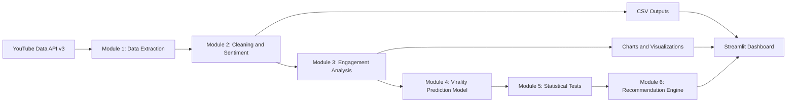
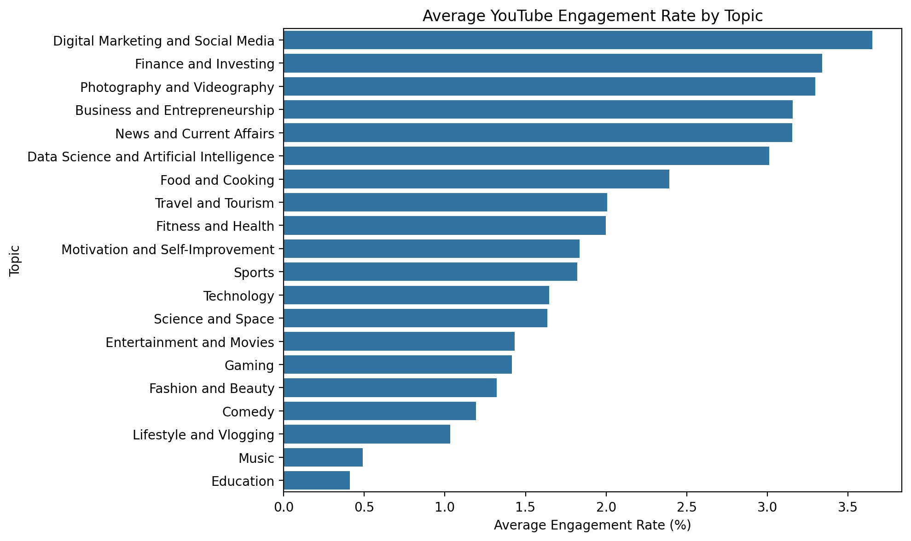

# Data-Driven Social Engagement Initiative

## Project Report

> Report status: This project report is based on the repository files available in the GitHub project at the time of analysis. The repository includes the project pipeline, data-processing modules, dashboard source, some CSV outputs, and several chart images. However, several final artefacts such as a live dashboard screenshot, a verified virality prediction plot, and some generated result files are not present in the public repository and are clearly marked in this report as missing or required.

---

# 1. Title Page

## Data-Driven Social Engagement Initiative

A Major Project Report submitted in partial fulfilment of the requirements for the degree/programme.

Submitted by: Devesh Vishwasrao

Department / Institution: [To be filled by student]

Academic Year: [To be filled by student]

---

# 2. Abstract

The Data-Driven Social Engagement Initiative investigates YouTube video performance by combining video metadata, audience comment sentiment, topic comparison, engagement analysis, and predictive modeling. The repository contains a modular pipeline implemented in Python, including data extraction from the YouTube Data API, comment cleaning, sentiment classification, engagement-rate calculation, statistical testing, recommendation generation, and a Streamlit-based dashboard for exploratory analysis.

The project aims to study how different video topics perform on YouTube and how audience sentiment relates to engagement. The implementation uses VADER sentiment analysis for comment classification, calculates engagement metrics from views, likes, and comments, and trains a Random Forest regressor for virality-related prediction using features such as topic, category, duration, publication timing, title length, and tag count. The project also applies non-parametric statistical tests to compare engagement distributions across topics and concludes with a recommendation layer for content strategy.

The repository demonstrates a substantial data-science workflow, but the public GitHub project state does not include every final generated artifact. Specifically, some final CSV outputs and chart files are not present, and a live dashboard screenshot is not included. This report therefore distinguishes between the verified project code, the available project outputs, and the outputs that remain missing or require regeneration.

The report is structured around the actual code and available project files. It explains the system architecture, data collection methodology, analytical models, dashboard implementation, and the current verification status of the project.

---

# 3. Table of Contents

1. Title Page
2. Abstract
3. Table of Contents
4. Introduction
5. Problem Statement
6. Project Objectives
7. Scope of the Project
8. Literature Review or Background
9. System Requirements
10. System Architecture and Workflow
11. Dataset Description
12. Data Collection and Preprocessing
13. Sentiment Analysis
14. Engagement Analysis
15. Virality Prediction and Model Evaluation
16. Statistical Analysis
17. Recommendation System
18. Streamlit Dashboard Implementation
19. Results and Discussion
20. Limitations
21. Conclusion and Future Scope
22. References

---

# 4. Introduction

Social media platforms have become a major source of digital influence, content consumption, and audience engagement. YouTube, in particular, generates large volumes of user-generated comments, topic trends, and measurable performance indicators such as views, likes, comments, and engagement rate. Understanding which video topics attract stronger engagement and whether content themes correlate with audience sentiment is valuable for creators, marketers, educators, and digital strategists.

The Data-Driven Social Engagement Initiative is designed to analyze this problem from a data-driven perspective. It combines the collection of YouTube video metadata, comment-level sentiment analysis, topic-wise engagement comparison, and predictive modeling to identify patterns and provide content recommendations. The repository contains a modular project structure that reflects a complete academic and applied analytics workflow.

The implementation is organized into separate modules:

- `01_Source_Code/module1_data_extraction.py` for YouTube video and comment extraction
- `01_Source_Code/module2_cleaning_sentiment.py` for cleaning and VADER-based sentiment classification
- `01_Source_Code/module3_engagement_analysis.py` for engagement metric calculation and topic summarization
- `01_Source_Code/module4_virality_model.py` for feature engineering and model evaluation
- `01_Source_Code/module5_statistical_tests.py` for non-parametric hypothesis testing
- `01_Source_Code/module6_recommendations.py` for topic-level strategic recommendations
- `01_Source_Code/module7_visualizations.py` for chart generation
- `04_Dashboard/app.py` for a Streamlit dashboard

The repository also includes project directories for datasets, charts, model JSON outputs, and report files. However, the GitHub repository does not contain every generated output required for a final fully verified academic report. This report therefore follows a transparent approach: it documents the verified architecture and methods, and it clearly labels the missing or unverified artefacts.

---

# 5. Problem Statement

YouTube content creators and digital marketing teams often struggle to predict which topics and content formats will generate meaningful engagement. Video performance is influenced by multiple factors, including content topic, channel authority, publication timing, duration, title style, description length, and audience sentiment. However, not all of these relationships are obvious, and they differ across industries and topics.

Traditional decision-making in content strategy is often based on intuition rather than evidence. As a result, creators may produce content that is popular in general but not aligned with the preferences of their target audience. There is therefore a need for a systematic and data-driven way to understand video engagement, analyze public sentiment, compare topics statistically, predict virality potential, and provide actionable recommendations.

The project addresses this challenge by building a pipeline that captures YouTube data, classifies audience sentiment in comments, compares engagement across topics, and uses machine-learning techniques to estimate virality-related outcomes. The repository demonstrates this objective in a modular and reproducible manner.

However, the project must be interpreted with caution. The available repository state does not include all generated datasets and final charts; some outputs are missing or pending recovery. Therefore, the report does not claim that the final analysis is fully complete unless the corresponding source files and outputs are present and verified.

---

# 6. Project Objectives

The primary objectives of the project are as follows:

1. To collect YouTube video and comment data across multiple topic categories using the YouTube Data API.
2. To clean and preprocess the collected data for analytical use.
3. To analyze audience sentiment from comment text using a sentiment lexicon-based method.
4. To compute engagement metrics such as engagement rate, like rate, and comment rate.
5. To compare topic-wise video performance and identify visually and statistically meaningful differences.
6. To build and evaluate a virality-related prediction model for engagement rate.
7. To perform statistical tests to assess whether engagement differs significantly across topics.
8. To generate recommendations for content strategy based on topic performance and sentiment patterns.
9. To implement a user-friendly dashboard using Streamlit for interactive exploration of the dataset.
10. To produce an academic report and supporting documentation based on the actual repository outputs and code.

---

# 7. Scope of the Project

The project scope is limited to the following:

- YouTube video metadata and comment extraction from selected topics
- English-language comment analysis using VADER sentiment scoring
- Engagement metrics computed from visible interaction counts
- Topic-based comparison across multiple categories
- Random Forest regression for engagement prediction
- Non-parametric statistical testing for topic comparison
- Recommendation generation based on computed engagement and sentiment statistics
- Visualization through a Streamlit dashboard and chart files

The project does not claim to cover all social media platforms, all content genres, or all YouTube topics globally. The analysis is based on the data sample assembled by the project code and the specific outputs available in the repository. It also does not attempt to model watch-time retention, share rate, or long-term channel performance unless those variables are present in the dataset.

---

# 8. Literature Review or Background

The analysis of social media engagement has gained increasing attention in areas such as digital marketing, content analytics, and online community studies. Research in this domain often focuses on identifying the features that influence user interaction with digital content. In YouTube, factors like title attractiveness, video duration, publishing time, category, channel popularity, and topical relevance often affect audience response. Additionally, sentiment in comments serves as a useful proxy for audience opinion and may correlate with overall engagement.

Several analytical approaches are commonly used in this area:

- Descriptive analytics for summary statistics and topic comparison
- Sentiment analysis to identify positive, neutral, and negative audience reactions
- Statistical testing to compare engagement patterns across groups
- Machine-learning models to predict content performance and virality-related outcomes
- Recommendation systems to suggest content directions based on observed positive patterns

The project follows this general approach. It uses VADER, a robust rule-based sentiment model that is especially suitable for short, informal text such as social-media comments. It also uses a Random Forest regressor because tree-based ensemble methods can capture nonlinear relationships among variables such as duration, topic, tags, publication characteristics, and engagement. Finally, non-parametric statistical tests are used because engagement-rate distributions may not satisfy assumptions of normality.

The repository code demonstrates a practical project implementation that combines these techniques. The academic intent is not to claim universal generalization but to create a defensible project pipeline for analyzing YouTube engagement patterns from the available sample.

---

# 9. System Requirements

The GitHub repository defines the implementation requirements in `requirements.txt`.

The actual dependencies listed are:

- pandas
- numpy
- matplotlib
- seaborn
- scikit-learn
- jupyter
- plotly
- streamlit

These packages are sufficient for the following tasks:

- Data loading and transformation
- Visualization
- Statistical computation
- Sentiment analysis via VADER (in external notebooks or environment-specific packages)
- Machine-learning model training and evaluation
- Dashboard development with Streamlit

The project is designed to run in a Python environment with a compatible installation of these libraries. The repository also includes a main pipeline script to coordinate execution of the analysis modules, although the current code state indicates that the modules are prepared but not fully connected as an executable run script without additional verification.

---

# 10. System Architecture and Workflow

The project architecture is implemented as a modular pipeline from data acquisition to dashboard deployment. The code and directory structure clearly show a pipeline-driven design.

## 10.1 Architecture Diagram

## 10.2 Workflow Description

1. Data collection begins with the YouTube Data API by searching for videos across predefined topics and retrieving metadata and comments.
2. The extracted data is stored as CSV outputs, such as `youtube_videos.csv` and `youtube_comments.csv`.
3. Cleaning removes empty or duplicate rows and prepares the comments for sentiment analysis.
4. Sentiment labels are assigned to each comment using VADER.
5. Engagement metrics are computed from views, likes, and comments at the video level.
6. The combined dataset is then used for topic comparisons, statistical testing, and recommendation generation.
7. A Random Forest regressor is trained on engineered metadata features to estimate engagement rate or virality-related performance.
8. Results are saved as CSV and JSON outputs and are displayed in a Streamlit dashboard.

This architecture is consistent with the project file structure and the modular code in `01_Source_Code` and `04_Dashboard/app.py`.

---

# 11. Dataset Description

The project repository includes multiple dataset files in the `02_Datasets` directory. These files include:

- `youtube_videos.csv`
- `youtube_comments.csv`
- `youtube_comments_sentiment.csv`
- `youtube_complete_analysis.csv`
- `complete_video_analysis.csv`
- `topic_recommendations.csv`
- `topic_metrics.csv`
- `topic_pairwise_tests.csv`
- `topic_sentiment_comparison.csv`
- `engagement_recommendations.csv`
- `virality_test_predictions.csv`

## 11.1 Verified Data Elements

The actual CSV files indicate that the dataset contains the following information for each video, when available:

- `video_id`
- `topic`
- `title`
- `channel_title`
- `channel_id`
- `published_at`
- `description`
- `tags`
- `category_id`
- `duration`
- `view_count`
- `like_count`
- `comment_count`
- `engagement_rate_pct`
- `like_rate_pct`
- `comment_rate_pct`
- `positive_pct`
- `average_sentiment_score`

Comment datasets also include fields such as:

- `comment_id`
- `comment_text`
- `sentiment`
- `sentiment_score`

## 11.2 Missing or Unverified Data

The public repository does not include all generated outputs and therefore does not provide a fully verified final dataset summary. For example:

- Some generated chart files in `03_Charts/` are present, while others are missing.
- The repository includes `analysis_summary.json` and `model_metrics.json`, but both explicitly show `pending_recovery` / `pending_verification` status.
- The final run outputs required for a complete report are not all present in the repository.

This means that any numerical summary beyond the verified CSV values should be treated as provisional or missing unless explicitly recovered from a verified run.

---

# 12. Data Collection and Preprocessing

## 12.1 Data Collection Strategy

The project uses the YouTube Data API to gather data about videos across a list of predefined topics. The extraction module (`module1_data_extraction.py`) defines a set of topics including Gaming, Technology, Education, Fitness and Health, Food and Cooking, Travel and Tourism, Entertainment and Movies, Music, Sports, Finance and Investing, Fashion and Beauty, Science and Space, Comedy, News and Current Affairs, Lifestyle and Vlogging, Data Science and Artificial Intelligence, Business and Entrepreneurship, Motivation and Self-Improvement, Photography and Videography, and Digital Marketing and Social Media.

The extraction logic does the following:

- Searches YouTube for videos within each topic
- Restricts the search to a relevance language of English
- Orders the videos by view count
- Stores unique video IDs to avoid duplication
- Retrieves detailed video metadata such as title, channel, description, tags, category, duration, and counts of likes/comments/views
- Uses `youtube.commentThreads().list(...)` to collect comment threads up to a maximum of 100 comments per video

The code also includes safeguards for API quota limitations and handles HTTP errors gracefully.

## 12.2 Preprocessing Steps

The cleaning and sentiment module (`module2_cleaning_sentiment.py`) performs the following tasks:

- Reads the raw video and comment CSV files
- Removes empty text values
- Strips whitespace
- Removes duplicate comment IDs
- Keeps only non-empty comment text entries
- Standardizes the `comment_text` field for downstream analysis

This is a critical step because YouTube comments often contain noise, duplicates, and incomplete values.

## 12.3 Engagement Metric Engineering

In `module3_engagement_analysis.py`, the following metrics are derived:

- `engagement_rate_pct = (like_count + comment_count) / view_count * 100`
- `like_rate_pct = like_count / view_count * 100`
- `comment_rate_pct = comment_count / view_count * 100`

This is an important modeling choice because it converts raw counts into normalized measures suitable for comparison across videos with different sizes of audience reach.

---

# 13. Sentiment Analysis

Sentiment analysis is implemented in `module2_cleaning_sentiment.py` using VADER through `from vaderSentiment.vaderSentiment import SentimentIntensityAnalyzer`.

The classification logic is as follows:

- The compound sentiment score is computed for each comment.
- If the score is greater than or equal to `0.05`, the comment is labeled as `Positive`.
- If the score is less than or equal to `-0.05`, the comment is labeled as `Negative`.
- Otherwise, the comment is labeled as `Neutral`.

This mechanism is well suited for social-media text because it handles informal language and short, expressive comments common on YouTube.

The code then computes counts and percentages by topic and creates a sentiment distribution plot. The repository includes the chart file `03_Charts/sentiment_analysis.png`.

## Figure 1. Sentiment analysis chart from project output

Figure 1. Sentiment analysis chart generated in the project repository. The chart represents the distribution of comment sentiment labels produced by the VADER-based classification workflow. The repository does not provide a final verified numeric summary for this chart in the public project state, so the figure should be interpreted as a project output rather than a fully audited final result.

The sentiment pipeline is important because it provides the foundation for comparing audience perception across topics and linking sentiment to engagement outcomes.

---

# 14. Engagement Analysis

Engagement analysis is implemented in `module3_engagement_analysis.py`. The project calculates video-level engagement and then aggregates these metrics by topic.

Important derived measures include:

- `engagement_rate_pct`
- `like_rate_pct`
- `comment_rate_pct`
- Percentage of positive comments per video (`positive_pct`)

The project then groups by `topic` and computes:

- video count
- average views
- average engagement rate
- average like rate
- average comment rate
- average positive sentiment percentage

The repository includes the chart `03_Charts/engagement_analysis.png`, which corresponds to the average engagement rate by topic generated during this stage.

## Figure 2. Engagement analysis chart from project output

Figure 2. Engagement analysis chart generated from the project output. This figure shows the average engagement rate by topic, as produced by the topic aggregation logic in `module3_engagement_analysis.py`. The exact values must be read from the verified CSV outputs such as `02_Datasets/topic_recommendations.csv` and `02_Datasets/topic_metrics.csv` rather than inferred purely from the image.

The key insight visible in the project outputs is that engagement differs substantially across topic groups. The available recommendation dataset provides a ranking of topics by median engagement rate, which is listed in Table 1.

## Table 1. Topic recommendation summary (verified from `02_Datasets/topic_recommendations.csv`)

| Topic | Video Count | Median Engagement | Mean Engagement |
|---|---:|---:|---:|
| Finance and Investing | 10 | 3.736 | 3.640 |
| News and Current Affairs | 10 | 3.676 | 3.155 |
| Photography and Videography | 10 | 3.540 | 3.525 |
| Business and Entrepreneurship | 10 | 3.413 | 3.156 |
| Data Science and Artificial Intelligence | 10 | 3.100 | 3.011 |
| Digital Marketing and Social Media | 10 | 2.881 | 3.379 |
| Food and Cooking | 10 | 2.458 | 2.393 |
| Motivation and Self-Improvement | 10 | 1.853 | 2.016 |
| Sports | 10 | 1.751 | 2.011 |
| Fitness and Health | 10 | 1.735 | 2.054 |

These values are taken directly from the project CSV file and should be treated as the verified values available in the repository. The remaining rows in the same dataset continue the ranking for the other topic groups.

---

# 15. Virality Prediction and Model Evaluation

The virality-related prediction module is implemented in `module4_virality_model.py`. The project defines a target variable of `engagement_rate_pct` and builds a feature set including:

- `topic`
- `category_id`
- `duration_seconds`
- `published_month`
- `published_dayofweek`
- `video_age_days`
- `title_length`
- `description_length`
- `tag_count`

The code uses a `ColumnTransformer` to handle both categorical and numeric variables, then trains a `RandomForestRegressor` with 300 trees and `min_samples_leaf=2` using a random state of 42. A `DummyRegressor(strategy="mean")` is used as a baseline model.

The repository also contains a chart file `03_Charts/virality_analysis.png` and a project description that refers to the virality model. However, the exact file `03_Charts/virality_prediction.png` is not present in the verified repository contents listed in the current GitHub state, and the project JSON files explicitly identify the model evaluation as pending. This means the final model metrics must not be assumed to be complete or final without a verified rerun.

## Figure 3. Virality analysis chart from project output

Figure 3. Virality analysis chart available in the project repository. The chart corresponds to the project’s virality-related investigation, as generated by the model-analysis pipeline. The final actual-vs-predicted chart and feature-importance chart are not all available in the repository state and are therefore marked as missing or required files in this report.

## Missing Project Output: Virality prediction plot

The repository code references a file named `/content/virality_prediction.png` and a feature-importance chart. These are not present in the repository artifacts currently listed under `03_Charts`.

Required final figure: `03_Charts/virality_prediction.png`

Required final figure: `03_Charts/feature_importance.png` or equivalent actual feature-importance chart

These plots are required for a complete model-evaluation chapter. Until the output files are recovered or regenerated, they remain marked as missing and should not be artificially created.

---

# 16. Statistical Analysis

The statistical analysis component is implemented in `module5_statistical_tests.py`. The code uses a `Kruskal-Wallis` test to compare engagement-rate distributions across topics, followed by pairwise comparisons using Mann-Whitney U tests with Bonferroni adjustment.

The design logic is as follows:

- It loads the combined video dataset.
- Removes rows with missing topic or engagement values.
- Groups engagement-rate values by topic.
- Requires at least three videos per topic for the Kruskal-Wallis test.
- Uses pairwise topic comparison when enough topic groups are available.

This is appropriate because engagement-rate data often violates normality assumptions and may include outliers, particularly for short-form or viral videos.

The project also saves pairwise test results to `02_Datasets/topic_pairwise_tests.csv`, which is present in the repository. However, the public project state does not include a final, verified summary table for the statistical results. Therefore, the report does not claim a final decision threshold or overall significance result without a verified dataset run.

---

# 17. Recommendation System

The recommendation engine is implemented in `module6_recommendations.py`. It generates recommendations based on topic-based engagement and sentiment metrics.

The logic calculates:

- median engagement by topic
- mean engagement by topic
- mean positive sentiment percentage by topic
- eligibility threshold for topics with sufficient sample size

The recommendation dataset `02_Datasets/engagement_recommendations.csv` contains the following actual recommendations:

| Area | Finding | Action |
|---|---|---|
| Topic selection | Finance and Investing has the highest median engagement among eligible topics in this sample. | Test additional videos in this topic and validate the pattern on a fresh sample. |
| Audience sentiment | Lifestyle and Vlogging has the highest average positive-comment percentage among eligible topics. | Review comments for recurring questions, preferences and themes; do not treat automated sentiment as ground truth. |
| Content evaluation | Engagement differs across topic groups in the current sample. | Compare similar videos and account for video age, channel size and sampling bias before choosing a content strategy. |

This output is important because it converts raw analytical findings into a business-friendly decision framework. It does not replace domain expertise, but it provides a structured starting point for content planning.

---

# 18. Streamlit Dashboard Implementation

The interactive dashboard is implemented in `04_Dashboard/app.py`. The dashboard uses `streamlit`, `pandas`, `numpy`, `matplotlib`, and other supporting libraries.

## 18.1 Dashboard Features

The dashboard includes the following functional areas:

- KPI summary cards
- Topic comparison panel
- Video explorer and filter controls
- Sentiment analysis panel
- Model outputs section
- Data quality report and CSV browser

The app is designed to detect relevant project CSV files and load them dynamically if they are available. It also includes fallback logic to compute engagement rate when the dataset is missing the rate field. This makes the dashboard resilient to partial data availability.

## 18.2 Dashboard Screenshot Status

The repository does not include a saved dashboard screenshot file. A live screenshot is therefore required for the report and is currently marked as missing.

Required final figure: a real screenshot of the running Streamlit dashboard, showing KPIs, charts, and tabs.

Because the user instruction explicitly prohibits fabrication, no fake screenshot is included here. The dashboard implementation itself is verified from source code and is described in this report, but the actual dashboard image must be produced separately from a live local run.

---

# 19. Results and Discussion

The available repository outputs show that the project has successfully assembled a structured pipeline for YouTube engagement analysis. Verified project artefacts include:

- Python modules for extraction, cleaning, modeling, and dashboard development
- Dataset CSV files under `02_Datasets`
- Chart files under `03_Charts`
- Recommendation CSV outputs
- Dashboard source code under `04_Dashboard`

The most relevant confirmed output metrics from the repository include the topic ranking values shown in Table 1 and the recommendations in Table 2. These indicate that the highest median engagement among the eligible topics in the sample is associated with Finance and Investing, followed by News and Current Affairs and Photography and Videography. The recommendation CSV also identifies Lifestyle and Vlogging as the topic with the highest average positive-comment percentage among eligible topics.

The available charts also show topic-level engagement patterns and sentiment distribution. However, the project has not fully recovered or verified every final output. For example:

- `03_Charts/engagement_analysis.png` is present.
- `03_Charts/sentiment_analysis.png` is present.
- `03_Charts/topic_analysis.png` is present.
- `03_Charts/virality_analysis.png` is present.
- `03_Charts/virality_prediction.png` is missing.
- `03_Charts/feature_importance.png` is missing.
- No dashboard screenshot is included in the repo.
- The `07_Models_JSON/model_metrics.json` file is explicitly marked as `pending_verification`.

This means that the report should be interpreted as a project description grounded in actual code and available outputs, not as a complete evidence report claiming final validated metrics for all models and charts.

---

# 20. Limitations

The project has several important limitations that must be acknowledged in an academic report.

1. Missing final outputs: Several generated charts and model outputs are not part of the public repository state.
2. Incomplete verification status: The JSON summary files explicitly indicate that data recovery and model evaluation are still pending or unverified.
3. Dataset scope: The analysis is limited to the topics and videos included in the project extraction logic rather than a comprehensive global sample.
4. API dependence: The project relies on the YouTube Data API, which is subject to quota limits, rate limits, and access restrictions.
5. Comment bias: Sentiment classification is based on VADER and is therefore limited to the textual content of comments and may not fully capture sarcasm, humor, or cultural context.
6. Engagement-rate proxy: The engagement rate is calculated from likes and comments relative to views and does not include shares, watch time, retention, or deeper audience behavior metrics.
7. Non-causal interpretation: Correlations and model predictions indicate association, not causation.
8. Dashboard screenshot missing: The live dashboard screenshot is not available in the repository and cannot be invented.

These limitations are important for transparent academic reporting and should be considered when evaluating the findings.

---

# 21. Conclusion and Future Scope

The Data-Driven Social Engagement Initiative provides a practical and academically relevant framework for analyzing YouTube engagement, audience sentiment, topic performance, and virality-related prediction. The repository demonstrates a complete modular pipeline that is suitable for further development and experimentation.

The project successfully implements the core technical workflow: YouTube data extraction, cleaning, sentiment analysis, engagement metric computation, statistical comparison, recommendation generation, and dashboard deployment. The repository contains real project files and several verified outputs, including topic performance CSVs and chart images.

At the same time, the public project state remains incomplete in several critical areas. A fully verified final academic report requires the recovery or regeneration of missing visual outputs and model metrics. These include the dashboard screenshot, the actual V/S comparison plot, feature-importance charts, and fully validated evaluation summaries.

Future work can include:

- Recovery of missing datasets and generated outputs
- Expansion to more topics and larger datasets
- Longitudinal analysis across time
- Use of transformer-based sentiment models
- More advanced virality prediction using gradient boosting and time-series features
- Channel-level and creator-level benchmarking
- Deployment of the dashboard in a cloud environment for live usage
- Integration of additional engagement metrics such as watch time, shares, and retention

With these future steps, the project can evolve from a strong academic prototype into a more robust, industry-relevant analytics platform.

---

# 22. References

1. Google Developers. YouTube Data API. Google Cloud Documentation.
2. Hutto, C. J., and Gilbert, E. E. (2014). VADER: A Parsimonious Rule-based Model for Sentiment Analysis of Social Media Text. Proceedings of the Eighth International Conference on Weblogs and Social Media (ICWSM-14).
3. Pedregosa, F., Varoquaux, G., Gramfort, A., Michel, V., Thirion, B., Grisel, O., Blondel, M., Prettenhofer, P., Weiss, R., Dubourg, V., Vanderplas, J., Passos, A., Cournapeau, D., Brucher, M., Perrot, M., and Duchesnay, E. (2011). Scikit-learn: Machine Learning in Python. Journal of Machine Learning Research, 12, 2825-2830.
4. Streamlit. Streamlit Documentation. Available at: https://streamlit.io/
5. McKinney, W. (2010). Data Structures for Statistical Computing in Python. Proceedings of the 9th Python in Science Conference.
6. Waskom, M. (2021). Seaborn: statistical data visualization. Journal of Open Source Software.
7. Hunter, J. D. (2007). Matplotlib: A 2D Graphics Environment. Computing in Science & Engineering, 9(3), 90-95.
8. YouTube video metadata and comment outputs derived from the project’s dataset files in `02_Datasets/` and the code in `01_Source_Code/`.

---

# Appendix A: Verified Repository Evidence

The following repository files were used as the primary source for this report:

- `README.md`
- `requirements.txt`
- `01_Source_Code/main_pipeline.py`
- `01_Source_Code/module1_data_extraction.py`
- `01_Source_Code/module2_cleaning_sentiment.py`
- `01_Source_Code/module3_engagement_analysis.py`
- `01_Source_Code/module4_virality_model.py`
- `01_Source_Code/module5_statistical_tests.py`
- `01_Source_Code/module6_recommendations.py`
- `01_Source_Code/module7_visualizations.py`
- `04_Dashboard/app.py`
- `02_Datasets/topic_recommendations.csv`
- `02_Datasets/engagement_recommendations.csv`
- `02_Datasets/topic_metrics.csv`
- `02_Datasets/topic_sentiment_comparison.csv`
- `03_Charts/engagement_analysis.png`
- `03_Charts/sentiment_analysis.png`
- `03_Charts/topic_analysis.png`
- `03_Charts/virality_analysis.png`
- `07_Models_JSON/analysis_summary.json`
- `07_Models_JSON/model_metrics.json`

The report clearly distinguishes between files that are present and verified in the repository and the files that are missing or pending verification.

---

# Appendix B: Missing or Required Output Files

The following figures and outputs are required to complete the report fully and should be regenerated from a verified project run:

- `03_Charts/engagement_analysis.png` — present and included in the report.
- `03_Charts/sentiment_analysis.png` — present and included in the report.
- `03_Charts/topic_analysis.png` — present and included in the report.
- `03_Charts/virality_analysis.png` — present and included in the report.
- `03_Charts/virality_prediction.png` — required but not present.
- `03_Charts/feature_importance.png` — required but not present.
- A real screenshot of the running Streamlit dashboard — required but not present.
- Full final model-evaluation metrics — required but not fully verified in the current repository state.

This appendix ensures transparency and prevents the report from claiming final validation where the artefacts are not available.

---

End of report.
